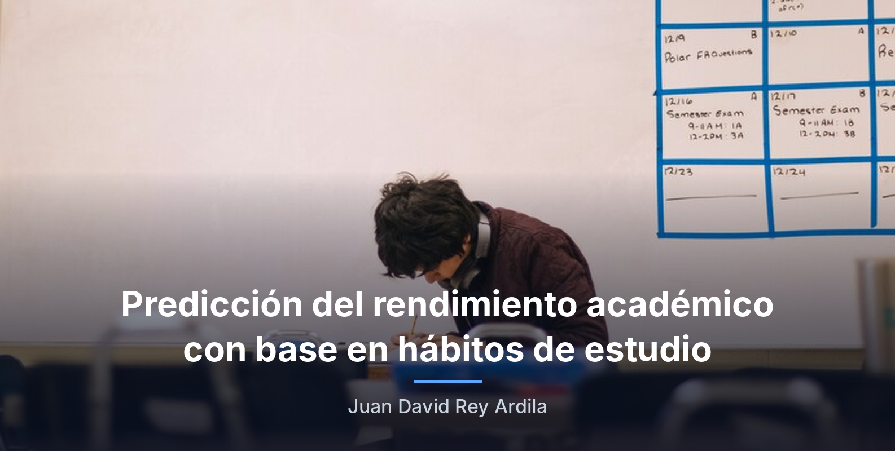

## Predicción del rendimiento académico con base en hábitos de estudio

### Video en YouTube

[Ver video del proyecto](URL_DE_YOUTUBE)

### Objetivo

Nuestro objetivo consiste en aplicar los modelos vistos en clase para predecir el rendimiento académico de los estudiantes y analizar las métricas obtenidas por cada modelo.

### Dataset

Este conjunto de datos ofrece una visión integral del rendimiento estudiantil y del comportamiento de aprendizaje, integrando factores académicos, demográficos, conductuales y psicológicos.

Fue creado a partir de la fusión de dos conjuntos de datos públicos de Kaggle, lo que dio como resultado un conjunto unificado de **14.003 registros de estudiantes** con **16 atributos**. Todos los registros están anonimizados y no contienen información de identificación personal.

🔗 [Ver dataset](https://www.kaggle.com/datasets/adilshamim8/student-performance-and-learning-style)

### Integrantes

- Juan David Rey Ardila - 2210080

